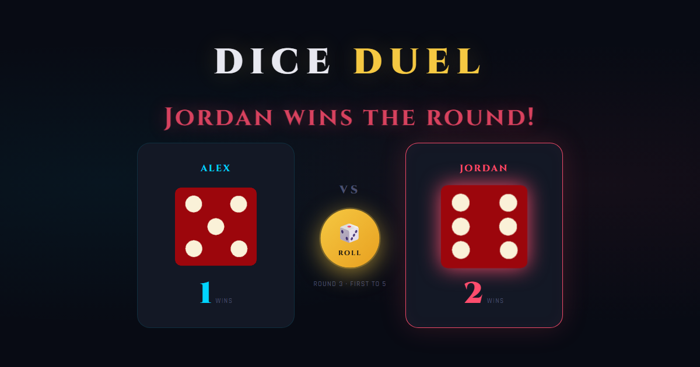

# 🎲 Dice Duel

> A fast-paced 2-player dice game. Enter your names, pick a target, and roll until someone wins.



🔗 **[Play Live →](https://umairjailani.github.io/Dice-Game/)**

---

## What It Does

- **2-player local** — sit across from each other, take turns rolling
- **Custom names** — enter your actual names before the game starts
- **Target score** — choose first to 3, 5, 7, or 10 wins
- **Round tracker** — live score + round count throughout the match
- **Win screen** — trophy animation + confetti when someone clinches it

## Tech Stack

- HTML / CSS / Vanilla JavaScript
- No frameworks, no dependencies, no build step — just open and play
- Hosted on GitHub Pages

## Run Locally

```bash
git clone https://github.com/UmairJailani/Dice-Game.git
cd Dice-Game
# open index.html in your browser, or use VS Code Live Server
```

---

## From Original to V2

This project started as a basic course exercise — a single HTML file that rolled two dice on page refresh. No button. No scores. No game loop.

| Original (`dicee.html`) | V2 (`index.html`) |
|---|---|
| Refresh page to roll | Roll button |
| No score tracking | First-to-N win condition |
| No player names | Custom player names |
| Single screen | Setup → Game → Win flow |
| Minimal styling | Premium dark UI, glow effects, confetti |
| `var` everywhere | Clean `const`/`let`, state object |
| Broken local paths | Relative paths, works everywhere |

The original file is preserved in git history as a reference point.

---

Made by [Umair Jailani](https://github.com/UmairJailani) · Rebuilt with [Claude Code](https://claude.ai/code)
